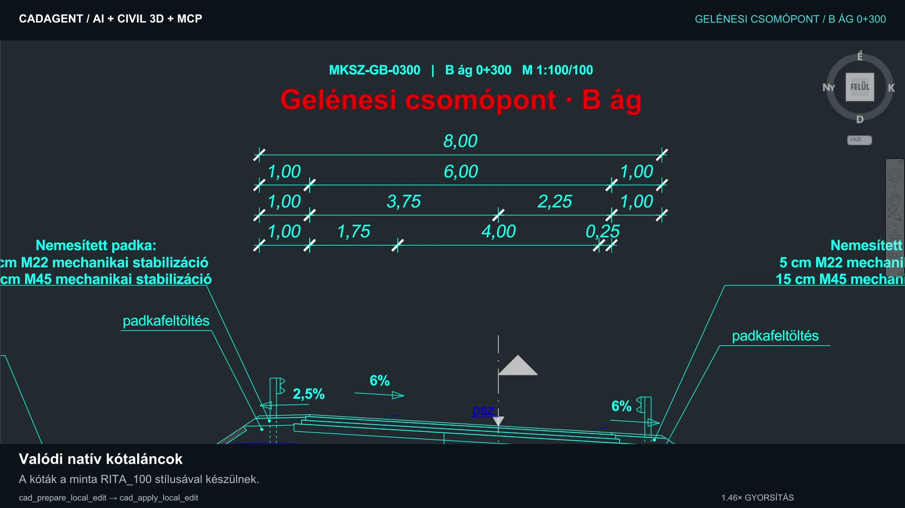
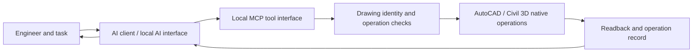

# CadAgent MCP · AI-assisted CAD automation

**Natural-language engineering tasks → structured tools → native AutoCAD / Civil 3D drawing operations.**

Public project demonstration by **Sebestény Máté**. Developed with AI assistance, combining infrastructure-design experience, workflow design, integration work and iterative testing.

## See it work

### [▶ Watch the five-minute demonstration](media/demo.mp4)

The recording shows a road cross-section being constructed and dimensioned with native drawing objects, related to a plan view and checked against a supplied visual reference. Planning cards and an operation log show the workflow alongside the CAD result.

**Video:** 5:00 · 1920 × 1080 · Hungarian captions · no audio. This is an edited presentation, with labelled speed changes; its runtime is not a task-completion benchmark. The example was prepared in October 2026 and predates the current local-model iteration.

## The engineering problem

Repetitive drafting still requires interpretation: which drawing to edit, which geometry to create, how to annotate it and how to check the result. CadAgent connects an AI client to structured CAD tools so those steps can be performed against actual drawing objects and reviewed by the engineer.

The recorded example includes cross-section geometry, native dimensions and plan-view annotations. It demonstrates a specific drafting workflow; it does not establish that every design task can be automated or replace engineering approval.

## How the parts connect

| Area | Project work |
| --- | --- |
| CAD integration | C# / .NET integration with native AutoCAD and Civil 3D APIs |
| AI tool use | Structured queries, creation and editing operations through MCP |
| Controlled changes | Target-drawing checks, prepared edits, review and operation status |
| Result checking | Native-object readback and scoped undo of supported operations |
| Local AI | A desktop interface connecting to Ollama and compatible local model runtimes |
| Delivery | Versioned internal packages and repeatable build / regression checks |

## Development status — 30 October 2026

The current private candidate is **R41**. In a separate Civil 3D test process, a local model completed a small synthetic drawing workflow: query a line, prepare and apply a reviewed copy, read back the result, then undo its own operation. Exported snapshots were reopened to check the geometry.

This is scoped evidence from an isolated source-built test assembly. It is **not acceptance of the final installer, every tool or every supported Civil version**. Broader installation and visual acceptance remain open.

A small private fine-tuning experiment has also been run. It has **not demonstrated a reliable task-level improvement**, and no fine-tuned model has been promoted as the default. Local model integration and model training are separate parts of the work.

See [verification scope and limitations](VERIFICATION.md).

## What is available here

This repository contains the **video, preview image and project description**. It is a portfolio showcase, not an installable plugin, runnable demo or active trial.

The implementation, CAD connector, installer, binaries, training data, model adapters and source drawings remain private while commercial distribution is evaluated. There is no endpoint to connect to and no bundled model or Autodesk component.

## Related work

- [Sebestény Máté / Altorrg](https://github.com/Altorrg)
- [Smart Redactor — document-redaction project](https://github.com/Altorrg/smart_redactor)

AutoCAD and Civil 3D are Autodesk products. This independent project is not presented as Autodesk-endorsed or certified.
